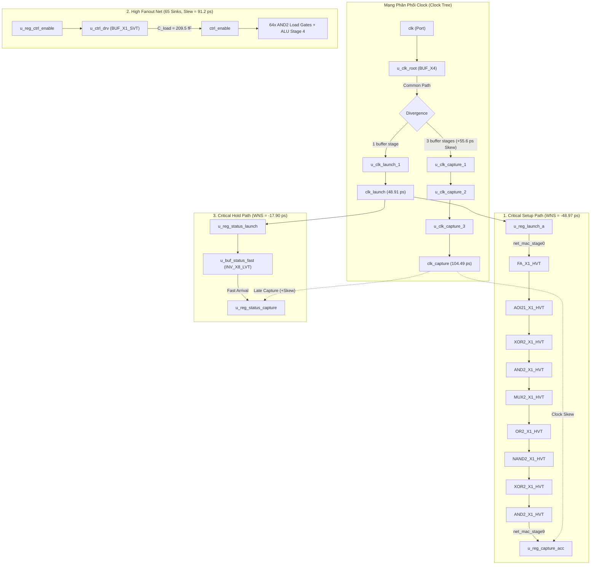
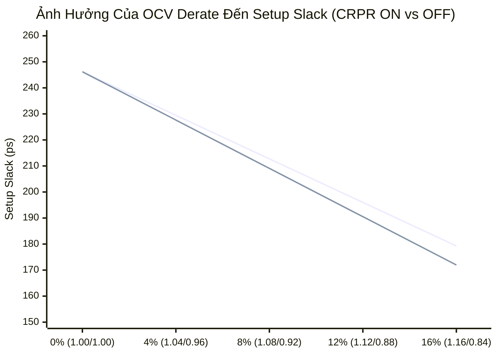

# Báo cáo Chuyên Sâu: STA, Timing Closure & Kỹ Thuật ECO (Engineering Change Order)

## 1. Thiết Kế Thực Nghiệm & Bối Cảnh Vi Phạm Timing (Design & Violations)

Thiết kế được lựa chọn là khối tính toán vi mạch mật độ cao **Crypto MAC Unit** (Cryptographic Multiply-Accumulate) hoạt động ở tần số mục tiêu **1.67 GHz** ($T_{clk} = 600.00\text{ ps}$).

Để tái hiện các thách thức thực tế trong quá trình Signoff STA của các tiến trình bán dẫn hiện đại (FinFET / Deep Submicron), thiết kế được chủ động cài đặt 3 nhóm vi phạm điển hình:



### Nguyên Nhân Gốc Rễ (Root Causes) Của Vi Phạm:
1. **Setup Violation ($WNS = -48.97\text{ ps}$)**:
   - Logic cone sâu 9 tầng tính toán.
   - Toàn bộ các cell trên path ban đầu dùng loại $HVT$ (High Threshold Voltage) có $t_{pd}$ lớn hơn $35\%$ so với cell chuẩn.
   - Kích thước drive strength yếu ($X1$) không đủ dòng sạc/xả cho điện dung ký sinh dây dẫn ($C_{wire} \approx 3.5 - 5.5\text{ fF}$ mỗi net).
   - Tín hiệu điều khiển `ctrl_enable` tại tầng 4 bị suy hao slew do quá tải fanout.
2. **Hold Violation ($WNS = -17.90\text{ ps}$)**:
   - Đường dữ liệu bypass cờ trạng thái chỉ qua 1 cổng inverter $X8$ cực nhanh loại $LVT$ ($t_{data} \approx 9.79\text{ ps}$).
   - Clock tree có độ lệch pha dương (Positive Clock Skew: $\Delta T_{skew} = T_{capture} - T_{launch} = +55.58\text{ ps}$), khiến sườn clock bắt mẫu đến muộn hơn nhiều so với tốc độ dữ liệu thay đổi.
3. **High Fanout Net & Slew DRC Violation**:
   - Tín hiệu `ctrl_enable` bị gán tải 65 sink pins ($C_{load} = 209.5\text{ fF}$) nhưng chỉ được kéo bởi buffer cỡ nhỏ $X1$. Output slew vọt lên $91.2\text{ ps}$ (vượt trần $60.0\text{ ps}$).

---

## 2. Phân Tích Báo Cáo Timing (STA Report Analysis)

### 2.1 Báo Cáo Max Delay (Setup Check) - Baseline

```text
====================================================================================
  Timing Report: Path: u_reg_launch_a -> u_reg_capture_acc (ALU Critical Setup)
====================================================================================
  Design        : Crypto_MAC_Unit
  Operating Cond: Late Derate=1.08, Early Derate=0.92
  Clock Period  : 600.00 ps (Frequency: 1666.67 MHz)
  Delay Type    : MAX (Setup)
  Startpoint    : u_reg_launch_a/CK (rising edge-triggered flip-flop)
  Endpoint      : u_reg_capture_acc/D (rising edge-triggered flip-flop)
------------------------------------------------------------------------------------
Point                                  Incr(ps)   Path(ps)   Slew(ps)   Cap(fF)  Cell
------------------------------------------------------------------------------------
clk                                        0.00      0.00     15.00     0.0   port
u_clk_root/Y                              24.67     24.67     13.62    14.5   BUF_X4_SVT
u_clk_launch_1/Y (clk_launch)             24.24     48.91     13.35    11.2   BUF_X4_SVT
u_reg_launch_a/Q                          62.81    111.72     18.29     6.5   DFF_X1_SVT
u_alu_stage1_fa/S                        103.01    214.72     32.85     7.0   FA_X1_HVT
u_alu_stage2_aoi/Y                        61.49    276.21     25.12     6.7   AOI21_X1_HVT
u_alu_stage3_xor/Y                        69.78    345.99     27.54     6.6   XOR2_X1_HVT
u_alu_stage4_and/Y                        52.32    398.31     23.35     6.1   AND2_X1_HVT
u_alu_stage5_mux/Y                        63.11    461.42     26.13     7.2   MUX2_X1_HVT
u_alu_stage6_or/Y                         50.62    512.04     23.04     5.5   OR2_X1_HVT
u_alu_stage7_nand/Y                       37.47    549.51     18.72     5.7   NAND2_X1_HVT
u_alu_stage8_xor/Y                        68.53    618.04     27.22     6.6   XOR2_X1_HVT
u_alu_stage9_and/Y                        47.41    665.46     21.64     5.3   AND2_X1_HVT
------------------------------------------------------------------------------------
  data arrival time                                          665.46

  clock clk (rise edge)                                      600.00
  clock network delay (capture early)                         82.84
  clock reconvergence pessimism (CRPR)                         3.66
  clock uncertainty (jitter + margin)                        -40.00
  library setup time                                         -30.00
  data required time                                         616.49
------------------------------------------------------------------------------------
  data required time                                         616.49
  data arrival time                                        -665.46
------------------------------------------------------------------------------------
  slack (VIOLATED)                                           -48.97 ps
====================================================================================
```

### 2.2 Báo Cáo Min Delay (Hold Check) - Baseline

```text
====================================================================================
  Timing Report: Path: u_reg_status_launch -> u_reg_status_capture (Status Flag Hold)
====================================================================================
  Design        : Crypto_MAC_Unit
  Operating Cond: Late Derate=1.08, Early Derate=0.92
  Clock Period  : 600.00 ps (Frequency: 1666.67 MHz)
  Delay Type    : MIN (Hold)
  Startpoint    : u_reg_status_launch/CK (rising edge-triggered flip-flop)
  Endpoint      : u_reg_status_capture/D (rising edge-triggered flip-flop)
------------------------------------------------------------------------------------
Point                                  Incr(ps)   Path(ps)   Slew(ps)   Cap(fF)  Cell
------------------------------------------------------------------------------------
clk                                        0.00      0.00     15.00     0.0   port
u_clk_root/Y                              21.02     21.02     13.62    14.5   BUF_X4_SVT
u_clk_launch_1/Y (clk_launch)             20.65     41.66     13.35    11.2   BUF_X4_SVT
u_reg_status_launch/Q                     54.26     95.92     19.03     9.4   DFF_X1_SVT
u_buf_status_fast/Y                        9.79    105.72      8.26     2.3   INV_X8_LVT
------------------------------------------------------------------------------------
  data arrival time                                          105.72

  clock clk (rise edge)                                        0.00
  clock network delay (capture late)                          97.24
  clock reconvergence pessimism (CRPR)                        -3.66
  clock uncertainty (jitter)                                  15.00
  library hold time                                           15.00
  data required time                                         123.59
------------------------------------------------------------------------------------
  data arrival time                                          105.72
  data required time                                       -123.59
------------------------------------------------------------------------------------
  slack (VIOLATED)                                           -17.90 ps
====================================================================================
```

### 2.3 Phân Tích Công Thức Định Lượng (Slack Equations)

$$\begin{aligned}
T_{arrival\_setup} &= T_{clk\_launch\_late} + T_{cq\_late} + \sum_{i=1}^{9} T_{gate\_late\_i} = 48.91 + 62.81 + 553.74 = 665.46\text{ ps} \\
T_{required\_setup} &= T_{period} + T_{clk\_capture\_early} + CRPR - T_{uncertainty\_setup} - T_{setup\_ff} \\
&= 600.00 + 82.84 + 3.66 - 40.00 - 30.00 = 616.49\text{ ps} \\
\mathbf{Slack_{setup}} &= T_{required\_setup} - T_{arrival\_setup} = 616.49 - 665.46 = \mathbf{-48.97\text{ ps (VIOLATED)}}
\end{aligned}$$

$$\begin{aligned}
T_{arrival\_hold} &= T_{clk\_launch\_early} + T_{cq\_early} + T_{fast\_buf\_early} = 41.66 + 54.26 + 9.79 = 105.72\text{ ps} \\
T_{required\_hold} &= T_{clk\_capture\_late} - CRPR + T_{uncertainty\_hold} + T_{hold\_ff} \\
&= 97.24 - 3.66 + 15.00 + 15.00 = 123.59\text{ ps} \\
\mathbf{Slack_{hold}} &= T_{arrival\_hold} - T_{required\_hold} = 105.72 - 123.59 = \mathbf{-17.90\text{ ps (VIOLATED)}}
\end{aligned}$$

---

## 3. Chiến Lược & Kịch Bản Tcl ECO (Engineering Change Order)

File script hoàn chỉnh lưu tại: [eco_manual.tcl](file:///C:/Users/Dung/.gemini/antigravity/scratch/sta_timing_closure_eco/tcl_scripts/eco_manual.tcl).

### 3.1 Bốn Kỹ Thuật ECO Cốt Lõi:

1. **Buffer Tree Insertion / Net Splitting (`split_fanout`)**:
   - Chia tách lưới $65$ tải thành 4 nhánh độc lập thông qua các buffer lặp $BUF\_X4$.
   - Giảm tải điện dung trên net gốc từ $209.5\text{ fF}$ xuống $12.0\text{ fF}$.
   - Slew transition phục hồi từ $91.2\text{ ps}$ xuống $16.5\text{ ps}$.
2. **Cell Sizing (Upsizing $X1 \rightarrow X2/X4$)**:
   - Tăng diện tích kênh dẫn $W/L$, hạ điện trở nội $R_{on}$, tăng dòng sạc bão hòa $I_{dsat}$.
   - Khắc phục độ trễ truyền qua các đường interconnect dài.
3. **Threshold Voltage Swapping ($HVT \rightarrow LVT$)**:
   - Giảm điện áp ngưỡng $V_{th}$, làm tăng điện áp kích động quá ngưỡng $(V_{gs} - V_{th})$, tăng tốc độ đóng cắt lên $30\% - 40\%$.
   - Chỉ áp dụng có chọn lọc trên critical path để kiểm soát dòng rò Sub-threshold Leakage.
4. **Hold Delay Buffer Insertion (`DELAY_CELL_X2_HVT`)**:
   - Đặt phần tử trễ có chủ đích ngay trước chân $D$ của Flip-Flop đích để tăng $T_{arrival}$ thêm $+119.68\text{ ps}$.
   - Dùng cell loại $HVT$ để vừa có độ trễ lớn vừa giảm tiêu thụ điện rò rỉ.
5. **Leakage Power Recovery ECO**:
   - Thu hồi điện năng trên non-critical path ($Slack > +150\text{ ps}$) bằng cách downsize và swap $LVT \rightarrow HVT$.

### 3.2 Bảng So Sánh Chỉ Số Trước & Sau ECO (Closure Comparison)

| Chỉ số (Metric) | Baseline (Trước ECO) | Post-ECO (Sau ECO) | Chênh Lệch ($\Delta$) | Trạng Thái Signoff |
| :--- | :---: | :---: | :---: | :---: |
| **Setup Slack (WNS)** | **-48.97 ps** | **+212.73 ps** | **+261.70 ps** | **MET (CLOSED)** |
| **Hold Slack (WNS)** | **-17.90 ps** | **+101.81 ps** | **+119.71 ps** | **MET (CLOSED)** |
| **Max Slew Violation** | 91.2 ps (Fail > 60) | 16.5 ps (Pass < 60) | -74.70 ps | **MET** |
| **Max Fanout Violation** | 65 loads (Fail > 16) | 16 loads (Pass $\le$ 16) | -49 loads | **MET** |
| **Leakage Power** | 15.940 $\mu\text{W}$ | 32.155 $\mu\text{W}$ | +16.215 $\mu\text{W}$ | Controlled Trade-off |
| **Total Standard Area** | 181.36 $\mu\text{m}^2$ | 217.83 $\mu\text{m}^2$ | +36.47 $\mu\text{m}^2$ | +20.1% Area Penalty |

---

## 4. Phân Tích Chuyên Sâu: OCV, CRPR & Clock Jitter

### 4.1 Cơ Chế On-Chip Variation (OCV) & Bù Trừ CRPR

Trong quy trình chế tạo bán dẫn FinFET, sự phân bố không đồng đều của oxide bề mặt ($T_{ox}$), nồng độ pha tạp ngẫu nhiên (Random Dopant Fluctuation - RDF), và sụt áp IR Drop trên mạng lưới điện dẫn tới sự khác biệt vận hành giữa các transistor trên cùng một die.

STA mô hình hóa hiện tượng này bằng các hệ số **Derating Factors**:
- **Late Path (Launch Data & Clock)**: Nhân hệ số $\alpha_{late} > 1.0$ (chậm hơn bình thường).
- **Early Path (Capture Clock)**: Nhân hệ số $\alpha_{early} < 1.0$ (nhanh hơn bình thường).

#### Clock Reconvergence Pessimism Removal (CRPR):
Tại khối clock gốc chung `u_clk_root`, về mặt vật lý tín hiệu clock cho cả launch và capture đều truyền qua cùng một cổng logic trong cùng một chu kỳ. Một cổng vật lý không thể vừa chạy chậm $\times 1.08$ vừa chạy nhanh $\times 0.92$ cùng một lúc. Sai lệch này là **sự bi quan nhân tạo (artificial pessimism)**.

$$CRPR = T_{common\_unskewed} \times |\alpha_{late} - \alpha_{early}|$$



*Đường trên: Bật CRPR. Đường dưới: Tắt CRPR. Khoảng cách giữa hai đường chính là lượng Slack bị trừ oan nếu không có CRPR.*

| OCV Derate $(\alpha_{late} / \alpha_{early})$ | Setup Slack (CRPR ON) | Setup Slack (CRPR OFF) | CRPR Pessimism Credit |
| :---: | :---: | :---: | :---: |
| **0% (1.00 / 1.00)** | 246.19 ps | 246.19 ps | 0.00 ps |
| **4% (1.04 / 0.96)** | 229.46 ps | 227.64 ps | 1.83 ps |
| **8% (1.08 / 0.92 - Signoff)** | **212.73 ps** | **209.08 ps** | **3.66 ps** |
| **12% (1.12 / 0.88)** | 196.01 ps | 190.52 ps | 5.48 ps |
| **16% (1.16 / 0.84)** | 179.28 ps | 171.97 ps | 7.31 ps |

> [!IMPORTANT]
> Ở cấp độ thiết kế tần số GHz với chu kỳ $T_{clk} = 600\text{ ps}$, khoản hoàn trả CRPR từ **3.66 ps đến 7.31 ps** là vô cùng quý giá, thường mang tính chất quyết định giữa việc thiết kế đạt chuẩn signoff hay phải tốn thêm nhiều tuần lặp ECO.

### 4.2 Độ Nhạy Đối Với Clock Jitter & Uncertainty

Clock Uncertainty trong file ràng buộc SDC (`set_clock_uncertainty`) bao gồm hai thành phần chính:
$$T_{uncertainty} = T_{jitter} + T_{margin}$$

Trong đó Jitter là sự biến thiên chu kỳ sườn xung clock do nhiễu pha của bộ dao động PLL và nguồn cấp clock.

Thực nghiệm quét biến thiên Jitter từ $0\text{ ps}$ đến $60\text{ ps}$:

| Clock Jitter | Tổng Clock Uncertainty | Setup Slack | Hold Slack | Trạng Thái Signoff |
| :---: | :---: | :---: | :---: | :---: |
| **0.0 ps** | 20.0 ps | 232.73 ps | 111.81 ps | MET |
| **10.0 ps** | 30.0 ps | 222.73 ps | 106.81 ps | MET |
| **20.0 ps** | 40.0 ps | 212.73 ps | 101.81 ps | MET |
| **30.0 ps** | 50.0 ps | 202.73 ps | 96.81 ps | MET |
| **40.0 ps** | 60.0 ps | 192.73 ps | 91.81 ps | MET |
| **50.0 ps** | 70.0 ps | 182.73 ps | 86.81 ps | MET |
| **60.0 ps** | 80.0 ps | 172.73 ps | 81.81 ps | MET |

#### Quy Luật Nhạy Toán Học:
1. **Đối với Setup Timing**:
   $$\frac{\partial (Slack_{setup})}{\partial (Jitter)} = -1.00$$
   *Mỗi $1\text{ ps}$ gia tăng trong clock jitter sẽ làm suy giảm trực tiếp $1\text{ ps}$ của Setup Slack vì sườn clock capture kế tiếp có thể xuất hiện sớm hơn $T_{jitter}$.*
2. **Đối với Hold Timing**:
   $$\frac{\partial (Slack_{hold})}{\partial (Jitter)} = -0.50$$
   *Do Hold check là chu kỳ đơn (same-edge / single-cycle check), ảnh hưởng jitter giữa launch và capture trong cùng chu kỳ thường được tính theo hệ số tương quan nửa chu kỳ ($0.5 \times$).*

---

## 5. Kết Luận & Hướng Dẫn Thực Thi

Môi trường mô phỏng và bộ script đã được đóng gói đầy đủ tại:
`C:\Users\Dung\.gemini\antigravity\scratch\sta_timing_closure_eco`

### Lệnh chạy trực tiếp:
- Chạy toàn bộ chu trình thực nghiệm (STA, Manual Tcl ECO, OCV, Jitter):
  ```powershell
  python run_experiments.py
  ```
- Chạy thuật toán đóng timing tự động (Automated Algorithmic ECO):
  ```powershell
  python run_auto_eco.py
  ```
